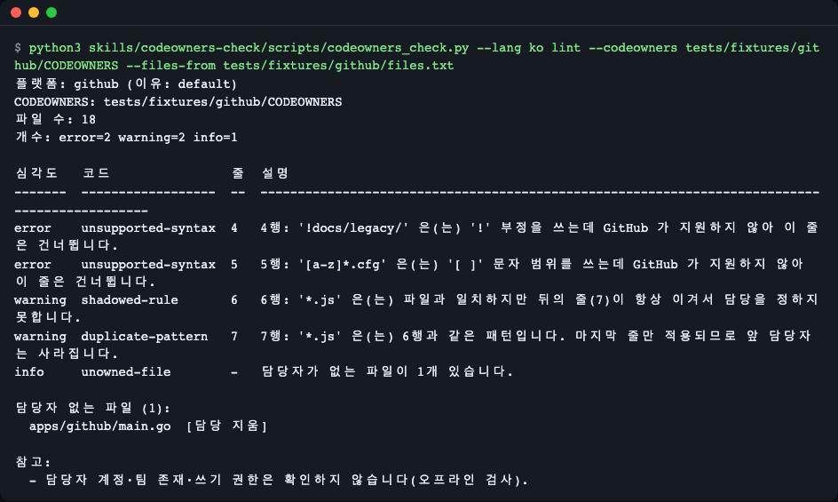
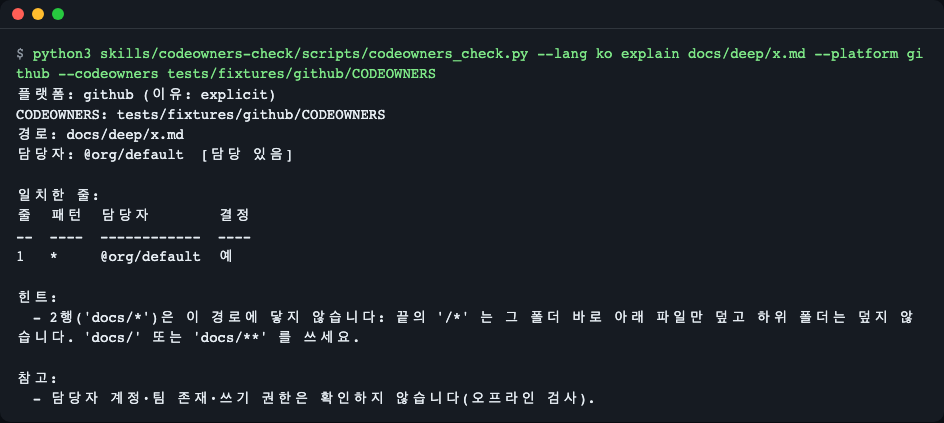
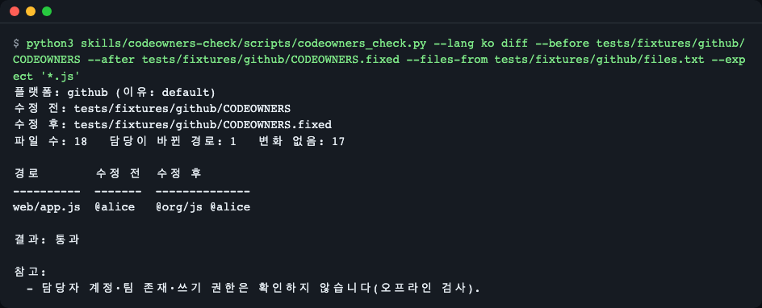
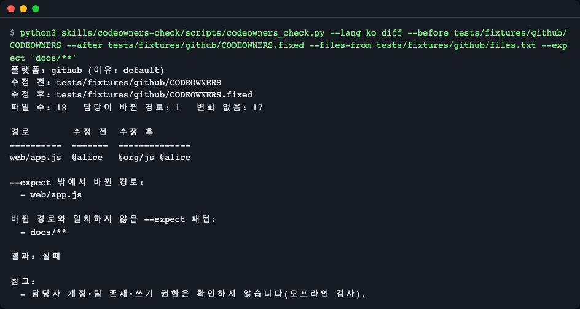
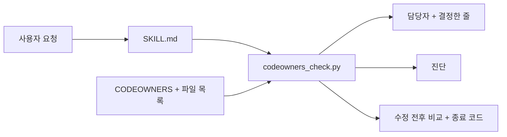

# codeowners-check

[English](README.md) | **한국어**

GitHub·GitLab 이 읽는 방식 그대로 CODEOWNERS 파일을 해석하는 에이전트 스킬입니다. "이 파일 담당은 누구지?", "이 수정이 의도한 곳만 바꾸나?" 같은 요청에서 에이전트가 눈대중 대신 오프라인 스크립트를 돌립니다. 파일별 담당자와 결정한 줄 번호를 보여 주고, 플랫폼이 조용히 건너뛰는 줄을 찾고, 수정 전후 담당 변화를 비교합니다.


*샘플 파일에 `lint` 를 돌린 화면: 4·5행은 GitHub 가 건너뛰고, 6행은 담당을 정하지 못합니다.*

## What it does (기능)
- 모든 파일을 모든 규칙에 대조해 **담당자·결정한 줄·패턴·상태**(`owned`, `no-rule`, `cleared`)를 냅니다. GitHub 는 마지막으로 일치한 줄만 쓰고, GitLab 은 섹션별로 계산합니다.
- GitHub 가 경고 없이 건너뛰는 줄(`!` 부정, `[a-z]` 범위, `\#`, 형식이 틀린 담당자), 죽은·가려진 규칙, 중복 패턴, 담당 없는 파일, `!` 제외 때문에 효과가 없어진 GitLab 규칙을 **찾습니다**.
- 경로 하나에 대해 일치한 모든 줄과 이기는 줄을 **설명**하고, .gitignore 습관으로 쓴 줄에는 고치는 방향을 알려 줍니다(예: `docs/*` 는 `docs/a/b.md` 를 덮지 않음).
- `diff --before 이전 --after 이후 --expect 패턴` 으로 **수정을 검증**합니다. `--expect` 밖의 경로 담당이 바뀌면 종료 코드 1 입니다.
- 오프라인, Python 표준 라이브러리만 사용(Python 3.10 이상). 토큰·네트워크가 필요 없습니다. 출력은 영어·한국어, JSON 은 같은 입력·같은 `--lang` 이면 바이트까지 같습니다.

## Install (설치)
**Claude Code**
```
/plugin marketplace add LeeGyeongPil/codeowners-check
/plugin install codeowners-check@codeowners-check-skill
```
**다른 에이전트(Agent Skills 표준)** — `skills/codeowners-check` 폴더를 에이전트의 스킬 폴더(예: 프로젝트의 `.agents/skills/`)에 복사합니다. Codex CLI 는 검증했습니다(아래 표 참고).

에이전트 없이 스크립트만 써도 됩니다: `python3 skills/codeowners-check/scripts/codeowners_check.py --help`.

## Use it (사용법)
에이전트에게 평소 말투로 요청합니다. 예:

1. "`docs/deep/x.md` 의 담당을 정하는 CODEOWNERS 줄이 어느 줄이야? 리뷰어가 아무도 지정되지 않아."
2. "CODEOWNERS 를 정리하고 `*.js` 파일만 담당이 바뀌는지 증명해 줘."
3. "GitLab CODEOWNERS 에 `[Ruby][2]` 와 `!/config/**/*.rb` 가 있어. `config/routes.rb` 는 어느 섹션 승인이 필요해?"

직접 실행할 수도 있습니다. 샘플 파일은 `tests/fixtures/github/` 에 있습니다. 아래 실행 결과는 `--lang ko` 로 낸 한국어 출력입니다.

**`docs/deep/x.md` 의 담당은 누구이고, 왜 `@org/docs` 가 아닌가?**
```
python3 skills/codeowners-check/scripts/codeowners_check.py --lang ko explain docs/deep/x.md --platform github --codeowners tests/fixtures/github/CODEOWNERS
```
```
플랫폼: github (이유: explicit)
CODEOWNERS: tests/fixtures/github/CODEOWNERS
경로: docs/deep/x.md
담당자: @org/default  [담당 있음]

일치한 줄:
줄  패턴  담당자        결정
--  ----  ------------  ----
1   *     @org/default  예

힌트:
  - 2행('docs/*')은 이 경로에 닿지 않습니다: 끝의 '/*' 는 그 폴더 바로 아래 파일만 덮고 하위 폴더는 덮지 않습니다. 'docs/' 또는 'docs/**' 를 쓰세요.

참고:
  - 담당자 계정·팀 존재·쓰기 권한은 확인하지 않습니다(오프라인 검사).
```

*`docs/*` 는 `docs/` 바로 아래 파일만 덮으므로 1행의 `*` 가 결정합니다.*

**건너뛰는 줄·죽은 줄 찾기**
```
python3 skills/codeowners-check/scripts/codeowners_check.py --lang ko lint --codeowners tests/fixtures/github/CODEOWNERS --files-from tests/fixtures/github/files.txt
```
```
플랫폼: github (이유: default)
CODEOWNERS: tests/fixtures/github/CODEOWNERS
파일 수: 18
개수: error=2 warning=2 info=1

심각도   코드                줄  설명
-------  ------------------  --  ---------------------------------------------------------------------------------------------
error    unsupported-syntax  4   4행: '!docs/legacy/' 은(는) '!' 부정을 쓰는데 GitHub 가 지원하지 않아 이 줄은 건너뜁니다.
error    unsupported-syntax  5   5행: '[a-z]*.cfg' 은(는) '[ ]' 문자 범위를 쓰는데 GitHub 가 지원하지 않아 이 줄은 건너뜁니다.
warning  shadowed-rule       6   6행: '*.js' 은(는) 파일과 일치하지만 뒤의 줄(7)이 항상 이겨서 담당을 정하지 못합니다.
warning  duplicate-pattern   7   7행: '*.js' 은(는) 6행과 같은 패턴입니다. 마지막 줄만 적용되므로 앞 담당자는 사라집니다.
info     unowned-file        -   담당자가 없는 파일이 1개 있습니다.

담당자 없는 파일 (1):
  apps/github/main.go  [담당 지움]

참고:
  - 담당자 계정·팀 존재·쓰기 권한은 확인하지 않습니다(오프라인 검사).
```
오류·경고가 있어 종료 코드 1 입니다(0 통과, 1 검사 실패, 2 입력 오류).

**수정 증명.** `CODEOWNERS.fixed` 는 6·7행을 `*.js @org/js @alice` 한 줄로 합친 파일입니다. `*.js` 파일만 바뀌어야 합니다:
```
python3 skills/codeowners-check/scripts/codeowners_check.py --lang ko diff --before tests/fixtures/github/CODEOWNERS --after tests/fixtures/github/CODEOWNERS.fixed --files-from tests/fixtures/github/files.txt --expect '*.js'
```
```
플랫폼: github (이유: default)
수정 전: tests/fixtures/github/CODEOWNERS
수정 후: tests/fixtures/github/CODEOWNERS.fixed
파일 수: 18   담당이 바뀐 경로: 1   변화 없음: 17

경로        수정 전  수정 후
----------  -------  --------------
web/app.js  @alice   @org/js @alice

결과: 통과

참고:
  - 담당자 계정·팀 존재·쓰기 권한은 확인하지 않습니다(오프라인 검사).
```

*종료 0: 바뀐 경로가 정확히 하나이고 `--expect '*.js'` 안에 있습니다.*

기대를 잘못 주면(`--expect 'docs/**'`) 같은 diff 가 종료 1 로 실패합니다(출력 일부):
```
--expect 밖에서 바뀐 경로:
  - web/app.js

바뀐 경로와 일치하지 않은 --expect 패턴:
  - docs/**

결과: 실패
```

*종료 1: 예상하지 못한 경로를 건드린 수정입니다.*

**GitLab** — `--platform gitlab` 을 지정합니다(파일 위치만으로 항상 알 수는 없습니다):
```
python3 skills/codeowners-check/scripts/codeowners_check.py --lang ko lint --platform gitlab --codeowners tests/fixtures/gitlab/CODEOWNERS --files-from tests/fixtures/gitlab/files.txt
```
```
플랫폼: gitlab (이유: explicit)
CODEOWNERS: tests/fixtures/gitlab/CODEOWNERS
파일 수: 8
개수: error=0 warning=1 info=2

심각도   코드                         줄  설명
-------  ---------------------------  --  -------------------------------------------------------------------------------------------
warning  ineffective-after-exclusion  10  10행: '/config/routes.rb' 은(는) Ruby 섹션에서 앞서 제외된 파일에만 일치해 효과가 없습니다.
info     section-merged               11  11행: 섹션 Docs 이(가) 여러 번 나옵니다(줄 3, 11). 하나로 합쳐집니다.
info     unowned-file                 -   담당자가 없는 파일이 1개 있습니다.

담당자 없는 파일 (1):
  pom.xml  [제외됨]

참고:
  - 담당자 계정·팀 존재·쓰기 권한은 확인하지 않습니다(오프라인 검사).
  - GitLab 동작은 문서 기준으로 재현했으며 서버에 연결하지 않았습니다(gitlab-org/gitlab#585698 참고).
```

이 GitLab 예시는 경고가 있어 종료 코드 1 입니다(`--fail-on` 기본값이 `warning`).

**언어.** 출력 언어는 `--lang en|ko`, 없으면 `CODEOWNERS_CHECK_LANG`, 그다음 `LC_ALL`, `LC_MESSAGES`, `LANG` 순으로 정하며 한국어가 아니면 영어입니다. JSON 필드와 진단 코드는 언어와 무관합니다. 기계가 읽을 출력은 `--format json` 을 붙입니다.

## GitHub vs GitLab semantics (GitHub 와 GitLab 의 차이)
스크립트가 재현하는 차이입니다. 출처는 표 아래에 있습니다.

| 항목 | GitHub | GitLab |
|---|---|---|
| 결정하는 줄 | 마지막으로 일치한 줄 | 섹션별로 마지막으로 일치한 줄 |
| 섹션·승인 수·`^[Optional]` | 지원하지 않음 | `[Name]`, `[Name][2]`, `^[Name]`, 섹션 이름은 대소문자 구분 없이 합쳐짐 |
| `!pattern` | 지원하지 않음, 그 줄은 건너뜀 | 그 섹션에서 일치 파일을 제외하며 뒤의 줄로 되돌릴 수 없음 |
| `[a-z]` 범위, `\#` | 지원하지 않음, 그 줄은 건너뜀(`\#` 도 건너뜀) | 범위 지원, `\#` 는 특별 처리 없음 |
| `docs/*` | `docs/` 바로 아래 파일만, `docs/a/b.md` 는 아님 | 같음 |
| `docs/**` | `docs/` 아래 전부 | 한 단계만(`docs/` 또는 `docs/**/*` 사용) |
| 담당자 없는 줄 | 일치한 경로의 담당을 지움 | 섹션에 헤더 담당자가 없으면 효과 없음 |
| 파일 위치(먼저 찾은 것) | `.github/CODEOWNERS`, `CODEOWNERS`, `docs/CODEOWNERS` | `CODEOWNERS`, `docs/CODEOWNERS`, `.gitlab/CODEOWNERS` |
| 크기 한도 | 3 MB, 더 큰 파일은 불러오지 않으므로 스크립트는 규칙을 적용하지 않고 참고 문구를 붙임(lint 는 `file-too-large` 보고) | 문서에 없음 |

출처(확인 2026-11-18): [GitHub Docs, About code owners](https://docs.github.com/en/repositories/managing-your-repositorys-settings-and-features/customizing-your-repository/about-code-owners), [GitLab Docs, Code Owners syntax reference](https://docs.gitlab.com/user/project/codeowners/reference/), [gitlab-org/gitlab#585698](https://gitlab.com/gitlab-org/gitlab/-/issues/585698)(GitLab 문서와 서버 동작의 차이 보고). 전체 표는 `skills/codeowners-check/references/syntax.md` 입니다.

## Commands & exit codes (명령과 종료 코드)
모든 명령은 `--platform auto|github|gitlab`, `--format table|json`, `--out FILE`, `--lang en|ko` 와 입력 옵션 `--root DIR`, `--files-from FILE|-` 를 받습니다(`--codeowners PATH` 는 `diff` 를 뺀 명령, `diff` 는 `--before`·`--after`).

| 명령 | 용도 | 주요 옵션 |
|---|---|---|
| `resolve [PATH ...]` | 지정한 경로(없으면 전체 파일)의 담당자·결정한 줄·상태 | `--files-from -` |
| `explain PATH` | 일치한 모든 줄, 이기는 줄, 힌트 | `--codeowners` |
| `lint` | 건너뛰는 줄, 죽은·가려진 규칙, 담당 없는 파일 | `--fail-on error\|warning\|never`(기본 `warning`) |
| `diff` | 수정 전후 담당 비교 | `--before`, `--after`, `--expect PATTERN`(반복 가능), `--expect-none` |

| 종료 코드 | 뜻 |
|---|---|
| 0 | 통과 |
| 1 | 검사 실패: `--fail-on` 이상의 `lint` 진단, 또는 `diff` 가 `--expect` 밖 경로를 바꿨거나 `--expect` 가 아무것도 못 맞췄거나 새 파일에 새 오류가 생김 |
| 2 | 입력 오류(파일 없음, 빈 파일 목록, `--before` 누락). 오류 줄에 고치는 방법이 있음 |

`--out FILE` 은 결과를 그 파일에도 씁니다(`.json` 이름이면 JSON 보고서이고 `--format table` 을 주지 않는 한 화면 출력도 JSON 이 됩니다. 기존 파일은 덮어씀). JSON 필드: `resolve` 는 `files[].owners/line/pattern/status`, `lint` 는 `findings[].code/severity/line` 과 `counts`, `diff` 는 `changed`, `unexpected`, `ineffective_expect`, `new_errors`, `ok`. 전체 설명은 `references/syntax.md` 에 있습니다.

## Verified behavior (검증 결과)
<!-- skill-eval:start -->
| 확인 | 결과 |
|---|---|
| 필요할 때 불림 | 12/13 |
| 필요 없을 때 안 불림 | 11/11 |
| 스킬로 푼 작업 | 7/7 |
| 스킬 없이 푼 작업(기준선) | 0/7 |
| 평균 점수 차이(Δ) | +0.58 |
| 가짜 스크립트를 잡아낸 비율 | 6/7 |
| Codex CLI | 작업 7/7 통과 · 확인됨 |

Claude Code 2.1.322 · sonnet · 케이스마다 3회 · 2026-11-18 측정 · codex-cli 0.154.0
<!-- skill-eval:end -->

## How it works (동작 원리)

- CODEOWNERS 관련 요청이면 에이전트가 `SKILL.md` 를 읽고, 규칙을 눈으로 읽는 대신 스크립트를 실행합니다.
- 스크립트는 CODEOWNERS 파일과 파일 목록(`--files-from`, 표준입력의 `git ls-files`, 또는 폴더를 훑는 `--root`)을 읽습니다. `--out FILE` 을 주지 않으면 파일을 쓰지 않고, 주면 그 파일을 씁니다(기존 파일은 덮어씀). 네트워크는 쓰지 않습니다.
- 출력은 줄 번호가 있는 표 또는 JSON 이라, 에이전트가 지어내지 않은 숫자로 답합니다.
- 확인하지 않는 것: 담당자 계정·팀이 존재하는지, 리뷰할 수 있는지. GitLab 규칙은 서버가 아니라 문서 기준으로 재현했고, 문서에 없는 부분(반복된 섹션의 승인 수 병합)은 가정이며 `skills/codeowners-check/references/syntax.md` 에 적어 두었습니다.

## How the agent uses it (에이전트의 사용 절차)
`SKILL.md` 는 에이전트에게 다음 순서를 지시합니다:
1. 현재 파일에 `lint` 를 돌려 기존 진단을 봅니다(먼저 옛 파일을 복사해 둡니다).
2. CODEOWNERS 를 수정합니다(GitHub 에서는 `!`, `[ ]` 를 쓰지 않음).
3. `lint` 를 다시 돌리고 `diff --before 이전 --after 이후 --expect 패턴` 을 실행합니다. 종료 1 은 의도하지 않은 변화가 있다는 뜻입니다.
4. 바뀐 경로, 결정한 줄 번호, 종료 코드를 스크립트 출력 그대로 인용해 보고합니다. 스크립트가 오류(종료 2)를 내면 그 줄을 인용하고, 담당자를 추측하지 않고 올바른 경로를 묻습니다.

## When to use it (언제 쓰나)
- 잘 맞는 경우: 에이전트가 CODEOWNERS 를 고치거나 디버깅하면서 수정 전후 담당 변화를 증거로 남기고 싶을 때.
- 잘 맞는 경우: 리뷰어가 지정되지 않았는데 어느 줄이 결정하는지 알아야 할 때.
- 범위 밖: 브랜치 보호 설정, 담당자 계정이 존재하는지(이쪽은 [codeowners-validator](https://github.com/mszostok/codeowners-validator) 같은 도구가 API 로 확인합니다), `.gitignore` 파일, git 이력으로 계산하는 담당.

## Development (개발)
```
uv sync && uv run pytest -q
```
`evals/` 는 평가 세트(발동·근접 미발동·작업 케이스와 픽스처, 채점기)입니다. 자기 에이전트에서는 `claude plugin eval` 로 돌립니다.

## Acknowledgements (감사)
테스트는 GitHub 일치 규칙의 독립 기준으로 PyPI 패키지 [`codeowners`](https://pypi.org/project/codeowners/) 0.9.0(MIT)을 사용합니다. 코드는 복사하지 않았습니다. 의미 규칙은 위에 링크한 GitHub·GitLab 문서를 따릅니다.

## License
MIT
