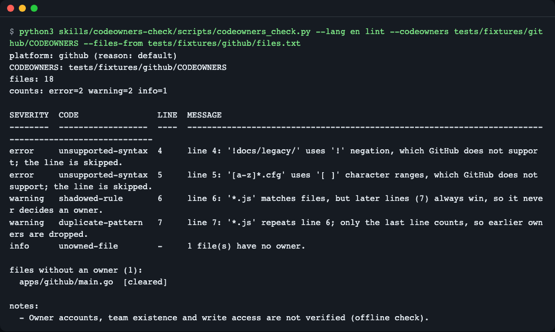
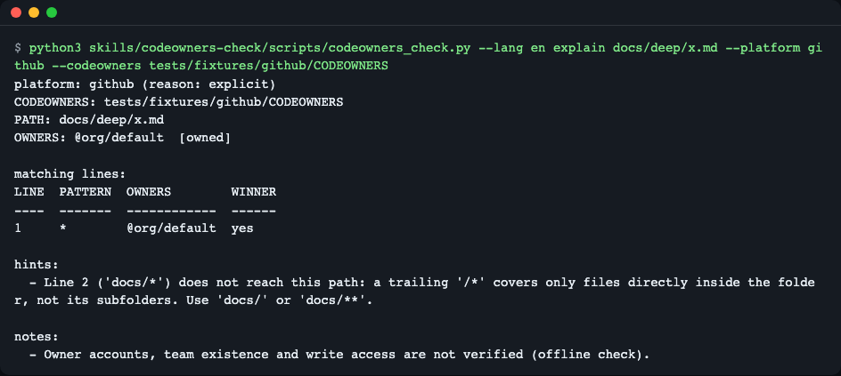
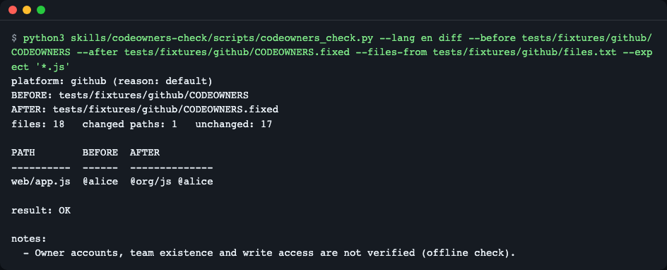
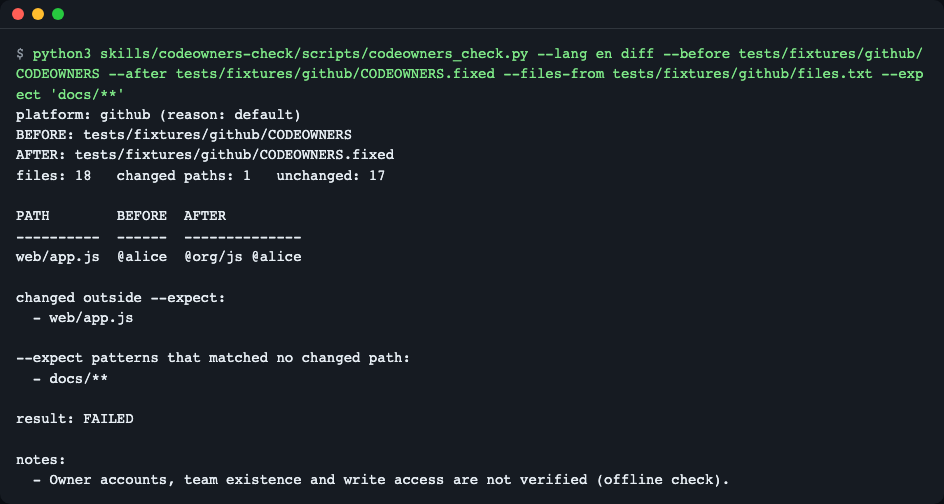
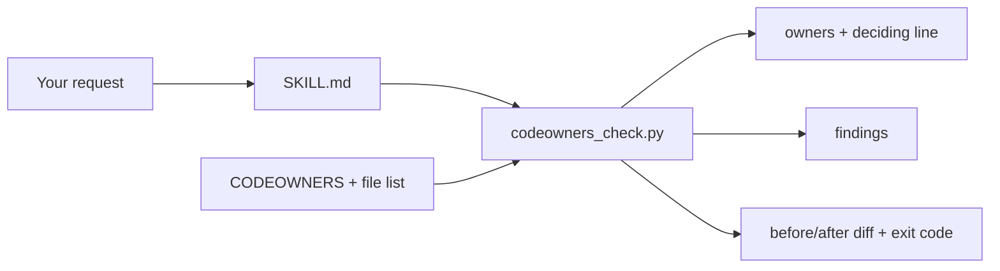

# codeowners-check

**English** | [한국어](README.ko.md)

An agent skill that reads a CODEOWNERS file the way GitHub or GitLab does. When you ask "who owns this file?" or "does this edit change only what I meant?", the agent runs a bundled offline script instead of guessing: it prints every file's owners with the deciding line number, finds lines the platform silently skips, and compares ownership before and after an edit.


*`lint` on the sample file: lines 4 and 5 are skipped by GitHub, line 6 never decides an owner.*

## What it does
- **Resolves** every file against every rule: owners, deciding line, pattern, and status (`owned`, `no-rule`, `cleared`). GitHub uses the last matching line; GitLab is evaluated per section.
- **Finds** lines GitHub skips without a warning (`!` negation, `[a-z]` ranges, `\#`, malformed owners), dead and shadowed rules, duplicate patterns, files without an owner, GitLab rules made useless by a `!` exclusion.
- **Explains** one path: all matching lines, the winner, and a hint when the line was written with .gitignore habits (for example `docs/*` does not cover `docs/a/b.md`).
- **Verifies an edit** with `diff --before OLD --after NEW --expect PATTERN`: exit code 1 when a path outside `--expect` changes owners.
- Works offline with the Python standard library only (Python 3.10+). No token, no network. Output is English or Korean; for the same input and `--lang`, JSON is byte-identical.

## Install
**Claude Code**
```
/plugin marketplace add LeeGyeongPil/codeowners-check
/plugin install codeowners-check@codeowners-check-skill
```
**Other agents (Agent Skills standard)** — copy `skills/codeowners-check` into the agent's skills folder (for example `.agents/skills/` in a project; Codex CLI is verified, see below).

The script alone also runs without any agent: `python3 skills/codeowners-check/scripts/codeowners_check.py --help`.

## Use it
Ask the agent in plain words, for example:

1. "Which CODEOWNERS line decides the owner of `docs/deep/x.md`? Nobody is requested as reviewer."
2. "Clean up our CODEOWNERS and prove that only `*.js` files change owners."
3. "Our GitLab CODEOWNERS has `[Ruby][2]` and `!/config/**/*.rb`. Which section needs approval for `config/routes.rb`?"

You can also run the script yourself. The sample files live in `tests/fixtures/github/`.

**Who owns `docs/deep/x.md`, and why not `@org/docs`?**
```
python3 skills/codeowners-check/scripts/codeowners_check.py --lang en explain docs/deep/x.md --platform github --codeowners tests/fixtures/github/CODEOWNERS
```
```
platform: github (reason: explicit)
CODEOWNERS: tests/fixtures/github/CODEOWNERS
PATH: docs/deep/x.md
OWNERS: @org/default  [owned]

matching lines:
LINE  PATTERN  OWNERS        WINNER
----  -------  ------------  ------
1     *        @org/default  yes

hints:
  - Line 2 ('docs/*') does not reach this path: a trailing '/*' covers only files directly inside the folder, not its subfolders. Use 'docs/' or 'docs/**'.

notes:
  - Owner accounts, team existence and write access are not verified (offline check).
```

*`docs/*` covers only files directly in `docs/`, so the catch-all `*` on line 1 decides.*

**Find skipped and dead lines**
```
python3 skills/codeowners-check/scripts/codeowners_check.py --lang en lint --codeowners tests/fixtures/github/CODEOWNERS --files-from tests/fixtures/github/files.txt
```
```
platform: github (reason: default)
CODEOWNERS: tests/fixtures/github/CODEOWNERS
files: 18
counts: error=2 warning=2 info=1

SEVERITY  CODE                LINE  MESSAGE
--------  ------------------  ----  -----------------------------------------------------------------------------------------------------
error     unsupported-syntax  4     line 4: '!docs/legacy/' uses '!' negation, which GitHub does not support; the line is skipped.
error     unsupported-syntax  5     line 5: '[a-z]*.cfg' uses '[ ]' character ranges, which GitHub does not support; the line is skipped.
warning   shadowed-rule       6     line 6: '*.js' matches files, but later lines (7) always win, so it never decides an owner.
warning   duplicate-pattern   7     line 7: '*.js' repeats line 6; only the last line counts, so earlier owners are dropped.
info      unowned-file        -     1 file(s) have no owner.

files without an owner (1):
  apps/github/main.go  [cleared]

notes:
  - Owner accounts, team existence and write access are not verified (offline check).
```
The command exits 1 because it found errors and warnings (exit codes: 0 ok, 1 check failed, 2 input error).

**Prove an edit.** `CODEOWNERS.fixed` merges lines 6 and 7 into `*.js @org/js @alice`. Only `*.js` files should change:
```
python3 skills/codeowners-check/scripts/codeowners_check.py --lang en diff --before tests/fixtures/github/CODEOWNERS --after tests/fixtures/github/CODEOWNERS.fixed --files-from tests/fixtures/github/files.txt --expect '*.js'
```
```
platform: github (reason: default)
BEFORE: tests/fixtures/github/CODEOWNERS
AFTER: tests/fixtures/github/CODEOWNERS.fixed
files: 18   changed paths: 1   unchanged: 17

PATH        BEFORE  AFTER
----------  ------  --------------
web/app.js  @alice  @org/js @alice

result: OK

notes:
  - Owner accounts, team existence and write access are not verified (offline check).
```

*Exit 0: exactly one path changed and it is inside `--expect '*.js'`.*

With the wrong expectation (`--expect 'docs/**'`) the same diff exits 1 (output shortened):
```
changed outside --expect:
  - web/app.js

--expect patterns that matched no changed path:
  - docs/**

result: FAILED
```

*Exit 1: the edit touched a path you did not expect.*

**GitLab** — pass `--platform gitlab` (it is not always detectable from the file location):
```
python3 skills/codeowners-check/scripts/codeowners_check.py --lang en lint --platform gitlab --codeowners tests/fixtures/gitlab/CODEOWNERS --files-from tests/fixtures/gitlab/files.txt
```
```
platform: gitlab (reason: explicit)
CODEOWNERS: tests/fixtures/gitlab/CODEOWNERS
files: 8
counts: error=0 warning=1 info=2

SEVERITY  CODE                         LINE  MESSAGE
--------  ---------------------------  ----  -----------------------------------------------------------------------------------------------------------
warning   ineffective-after-exclusion  10    line 10: '/config/routes.rb' only matches files already excluded earlier in section Ruby; it has no effect.
info      section-merged               11    line 11: section Docs appears more than once (lines 3, 11); the sections are merged.
info      unowned-file                 -     1 file(s) have no owner.

files without an owner (1):
  pom.xml  [excluded]

notes:
  - Owner accounts, team existence and write access are not verified (offline check).
  - GitLab behaviour is reproduced from the documentation; no server was contacted (see gitlab-org/gitlab#585698).
```

This GitLab example exits 1 because of the warning (`--fail-on` defaults to `warning`).

**Language.** Output is English or Korean: `--lang en|ko`, else `CODEOWNERS_CHECK_LANG`, else `LC_ALL`, `LC_MESSAGES`, `LANG`; anything that is not Korean falls back to English. JSON fields and finding codes do not depend on the language. Add `--format json` for machine-readable output.

## GitHub vs GitLab semantics
The script reproduces these differences. Sources are listed under the table.

| Topic | GitHub | GitLab |
|---|---|---|
| Which line decides | the last matching line | the last matching line per section |
| Sections, approvals, `^[Optional]` | not supported | `[Name]`, `[Name][2]`, `^[Name]`; names merge case-insensitively |
| `!pattern` | not supported, the line is skipped | exempts matching files from that section; a later line cannot undo it |
| `[a-z]` ranges, `\#` | not supported, the line is skipped (`\#` is skipped too) | ranges supported; `\#` has no special handling |
| `docs/*` | files directly in `docs/` only, not `docs/a/b.md` | same |
| `docs/**` | everything below `docs/` | one level only (use `docs/` or `docs/**/*`) |
| Ownerless line | clears ownership for matching paths | no effect unless the section has header owners |
| File location (first found) | `.github/CODEOWNERS`, `CODEOWNERS`, `docs/CODEOWNERS` | `CODEOWNERS`, `docs/CODEOWNERS`, `.gitlab/CODEOWNERS` |
| Size limit | 3 MB; a larger file is not loaded, so the script applies no rule and adds a note (lint reports `file-too-large`) | none documented |

Sources (checked 2026-11-18): [GitHub Docs, About code owners](https://docs.github.com/en/repositories/managing-your-repositorys-settings-and-features/customizing-your-repository/about-code-owners), [GitLab Docs, Code Owners syntax reference](https://docs.gitlab.com/user/project/codeowners/reference/), [gitlab-org/gitlab#585698](https://gitlab.com/gitlab-org/gitlab/-/issues/585698) (reported differences between the GitLab documentation and the server). The full table is `skills/codeowners-check/references/syntax.md`.

## Commands & exit codes
Every command takes `--platform auto|github|gitlab`, `--format table|json`, `--out FILE`, `--lang en|ko` and the input options `--root DIR` and `--files-from FILE|-` (`--codeowners PATH` for all but `diff`, which takes `--before` and `--after`).

| Command | Purpose | Main options |
|---|---|---|
| `resolve [PATH ...]` | owners, deciding line and status for the given paths (all files if none) | `--files-from -` |
| `explain PATH` | every matching line, the winner, hints | `--codeowners` |
| `lint` | skipped lines, dead and shadowed rules, unowned files | `--fail-on error\|warning\|never` (default `warning`) |
| `diff` | ownership before vs after an edit | `--before`, `--after`, `--expect PATTERN` (repeatable), `--expect-none` |

| Exit code | Meaning |
|---|---|
| 0 | ok |
| 1 | check failed: `lint` finding at or above `--fail-on`, or `diff` changed a path outside `--expect`, an `--expect` matched nothing, or the new file has a new error |
| 2 | input error (missing file, empty file list, missing `--before`); the error line says how to fix it |

`--out FILE` also writes the report to that file (a `.json` name writes the JSON report, and the screen output becomes JSON too unless you pass `--format table`; an existing file is overwritten). JSON fields: `resolve` has `files[].owners/line/pattern/status`; `lint` has `findings[].code/severity/line` and `counts`; `diff` has `changed`, `unexpected`, `ineffective_expect`, `new_errors` and `ok`. All of them are described in `references/syntax.md`.

## Verified behavior
<!-- skill-eval:start -->
| Check | Result |
|---|---|
| Triggers when it should | 12/13 |
| Stays quiet when it should not | 11/11 |
| Tasks solved with the skill | 7/7 |
| Tasks solved without it (baseline) | 0/7 |
| Mean score gain (Δ) | +0.58 |
| Tasks that catch a broken script | 6/7 |
| Codex CLI | 7/7 tasks · verified |

Measured 2026-11-18 with Claude Code 2.1.322 · sonnet · 3 runs per case · codex-cli 0.154.0
<!-- skill-eval:end -->

## How it works

- The agent loads `SKILL.md` when a request is about CODEOWNERS, and runs the script instead of reading the rules by eye.
- The script reads the CODEOWNERS file and a file list (`--files-from`, `git ls-files` on stdin, or `--root` to walk a folder). It writes no files unless you pass `--out FILE` (an existing file is overwritten), and uses no network.
- Output is a table or JSON with line numbers, so the agent reports numbers it did not make up.
- Not checked: whether an owner account or team exists or may review. GitLab rules are reproduced from its documentation, not from a server; where the docs are silent (merging approvals of repeated sections), the choice is an assumption listed in `skills/codeowners-check/references/syntax.md`.

## How the agent uses it
`SKILL.md` tells the agent to follow these steps:
1. Run `lint` on the current file to see existing findings (keep a copy of the old file first).
2. Edit CODEOWNERS (no `!`, no `[ ]` on GitHub).
3. Run `lint` again, then `diff --before OLD --after NEW --expect PATTERN`. Exit 1 means the edit changed something you did not intend.
4. Report the changed paths with the deciding line numbers and the exit code, quoting the script's output. If the script prints an error (exit 2), the agent quotes it and asks for the right path instead of guessing owners.

## When to use it
- Good fit: an agent is editing or debugging CODEOWNERS and you want proof of who owns which file before and after.
- Good fit: a reviewer was not requested and you need the deciding line.
- Not for: branch protection settings, whether an owner handle exists (tools such as [codeowners-validator](https://github.com/mszostok/codeowners-validator) query the API for that), `.gitignore` files, or ownership computed from git history.

## Development
```
uv sync && uv run pytest -q
```
`evals/` holds the evaluation set (trigger, near-miss and task cases with fixtures and graders). Run it against your own agent with `claude plugin eval`.

## Acknowledgements
The test suite uses the PyPI package [`codeowners`](https://pypi.org/project/codeowners/) 0.9.0 (MIT) as an independent oracle for GitHub matching; no code was copied from it. Semantics follow the GitHub and GitLab documentation linked above.

## License
MIT
